<!--
  ╔════════════════════════════════════════════════════════════════════╗
  ║  LEVEL 7 CLEARANCE GRANTED. You read the source. Fury would hire   ║
  ║  you on the spot.                                                  ║
  ║                                                                    ║
  ║  Three Easter eggs are hidden on this page:                        ║
  ║    1. Six Infinity Stones are scattered through the About section. ║
  ║    2. The classified dossier below it opens, if you dare.          ║
  ║    3. The footer has a post-credits scene. Hover over it.          ║
  ║                                                                    ║
  ║  Found all six stones? Open an issue on this repo titled           ║
  ║  "I have the stones" and the daily build pins your avatar in the   ║
  ║  Hall of Heroes. Excelsior.                                        ║
  ╚════════════════════════════════════════════════════════════════════╝
-->

<!-- ===== HEADER ===== -->


<div align="center">
  
  <br/>
  <a href="https://dhivakar1010.com/">
    
  </a>

  <p>
    <a href="https://www.dhivalabs.com/"></a>
    <a href="https://github.com/Dhiva-Labs"></a>
    <a href="https://dhivakar1010.com/"></a>
    <a href="https://www.linkedin.com/in/dhivakar-rajaram"></a>
    <a href="https://twitter.com/dhivakar1010"></a>
    <a href="mailto:dhivakar1010@gmail.com"></a>
    <a href="https://github.com/sponsors/Dhiva-Labs"></a>
  </p>

  
  <a href="https://github.com/dhivadhiva?tab=followers"></a>
  <a href="https://github.com/Dhiva-Labs"></a>
  
</div>

<!-- ===== ABOUT ===== -->
## 🦸 About · the origin story

I'm **Dhivakar Rajaram**, Founder and Principal Investigator at **Dhiva Labs**, an independent software R&D lab in Chennai, India. No vibranium, no super-soldier serum: a background in **AI / ML** (PG Certification, IIT Guwahati), a lot of Rust, and work that spans applied cryptography, machine intelligence, embedded systems and full-stack engineering.

Dhiva Labs is my Stark Tower, minus the budget. I turn research into shipped products: apps for Linux, Windows and Android, from a Monero wallet and a disk-recovery suite to an API workbench and a Linux ↔ Windows remote desktop. They ship through the Snap Store, a Launchpad PPA, the Microsoft Store, the Chrome Web Store, Firefox Add-ons and GitHub Releases, and I send fixes upstream to the **Monero** ecosystem, to Google's **safe-bindings** and **protobuf.dart**, and to Coinbase's wallet SDKs.

```rust
//! suit_up.rs · recompiled every morning by the GitHub Actions arc reactor

struct Dhivakar {
    role:      &'static str,
    based_in:  &'static str,
    education: &'static str,
    focus:     [&'static str; 5],
    shipping:  [&'static str; 6],
    upstream:  [&'static str; 7],
}

impl Avenger for Dhivakar {
    fn suit_up() -> Self {
        Self {
            role:      "Founder & Principal Investigator @ Dhiva Labs",
            based_in:  "Chennai, India (Earth-616)",
            education: "PG Certification, AI & ML — IIT Guwahati",
            focus:     ["Cross-platform apps", "Cryptography & Blockchain",
                        "Machine Intelligence", "Embedded Systems", "Full-Stack"],
            shipping:  ["Snap Store", "Launchpad PPA", "Microsoft Store",
                        "Chrome Web Store", "Firefox Add-ons", "GitHub Releases"],
            upstream:  ["vtnerd/monero-lws", "monero-project/monero",
                        "seraphis-migration/monero", "google/safe-bindings",
                        "google/protobuf.dart", "coinbase/coinbase-wallet-sdk",
                        "base/account-sdk"],
        }
    }

    fn motto(&self) -> &'static str {
        "The power of code compiles you."
    }

    fn weakness(&self) -> Option<&'static str> {
        Some("an unmerged upstream pull request")
    }
}
```

<!-- Easter egg 1: the six stones. Each one powers a different corner of the lab. -->
<div align="center">
  <sub>Six stones, six superpowers. Collect them all.</sub><br/>
  <a href="#-dhiva-labs" title="Space Stone · one codebase, every operating system"></a>
  <a href="#-tech-stack" title="Mind Stone · models that run offline, on your device"></a>
  <a href="#-dhiva-labs" title="Reality Stone · firmware, drivers and emulators that touch real hardware"></a>
  <br/>
  <a href="#-tech-stack" title="Power Stone · Rust, and C++ made memory-safe"></a>
  <a href="#-by-the-numbers" title="Time Stone · this page rebuilds itself every day at 06:00 IST"></a>
  <a href="#-upstream-contributions" title="Soul Stone · open source, and fixes sent back upstream"></a>
</div>

<br/>

<!-- Easter egg 2: the dossier. -->
<details>
<summary><b>🕶️ CLASSIFIED · S.H.I.E.L.D. dossier · Level 7 clearance required</b> <sub>(click if you dare)</sub></summary>
<br/>

| Field | Record |
| --- | --- |
| **Codename** | `dhivadhiva` |
| **Base of operations** | Chennai, India · Earth-616 |
| **Powers** | Reads whitepapers and ships products. Makes C++ safe with Rust. Compiles for three operating systems before breakfast. |
| **Weakness** | An unmerged upstream pull request |
| **Arc reactor** | Rust · Dart / Flutter · C / C++ · Python · Go |
| **Suit** | Mark  · one mark per open-source repository, upgraded automatically |
| **Power level** |  · ranked daily from  contributions |
| **Known associates** | Monero, Google safe-bindings, protobuf.dart, Coinbase wallet SDKs, Microsoft CMake Tools, Discord Embedded App SDK |
| **Post-credits scene** | iOS and macOS are next. Nobody leaves before the credits end. |

<!-- BRIEFING:START -->
**📡 Daily mission briefing** · <sub>regenerated Nov 9</sub>

> The daily build is the only Avenger that never misses a call.

| | |
| --- | --- |
| **Power level** | **Avenger** · 2,132 contributions, 221 pull requests merged |
| **Suit** | **Mark 49** · 49 open-source repositories, 84 releases shipped |
| **Latest mission** | [Update anyhow, tokio and rustls in the core lockfile](https://github.com/Dhiva-Labs/kilonova/pull/56) in [Dhiva-Labs/kilonova](https://github.com/Dhiva-Labs/kilonova), merged Nov 9 |
| **Latest drop** | [**dl_prism**](https://github.com/Dhiva-Labs/dl_prism) [`v0.2.0`](https://github.com/Dhiva-Labs/dl_prism/releases/tag/v0.2.0), Nov 7 |
| **Currently assembling** | [**chip8**](https://github.com/Dhiva-Labs/chip8), last push Nov 9 |
<!-- BRIEFING:END -->

</details>

<!-- ===== HALL OF HEROES ===== -->
<details>
<summary><b>🏛️ Hall of Heroes</b> <sub>everyone who collected all six stones</sub></summary>
<br/>

<!-- HEROES:START -->
<p align="center"><sub>Nobody has collected all six stones yet. Be the first: find them, then open an issue titled <b>"I have the stones"</b>.</sub></p>
<!-- HEROES:END -->

</details>

<picture>
  <source media="(prefers-color-scheme: dark)" srcset="https://raw.githubusercontent.com/dhivadhiva/dhivadhiva/output/github-snake-dark.svg" />
  <source media="(prefers-color-scheme: light)" srcset="https://raw.githubusercontent.com/dhivadhiva/dhivadhiva/output/github-snake.svg" />
  
</picture>

<!-- ===== NUMBERS ===== -->
## 📊 By the Numbers

<div align="center">
  
  
  
  
  <br/>
  
  
  
  
</div>

<br/>

<div align="center">
  
  
</div>

<!-- LANGS:START -->
<div align="center">
  <sub>Code across 49 Dhiva Labs repositories, by size</sub><br/>
  
  
  
  
  
  
  
  
</div>
<!-- LANGS:END -->

<p align="center">
  <sub>Numbers, languages, activity, releases, featured cards, extensions and upstream PRs are rebuilt daily by GitHub Actions</sub>
  
</p>

<!-- ===== ACTIVITY ===== -->
## ⚡ Recent Activity

<!-- ACTIVITY:START -->
- 🟣 **Merged** [Update anyhow, tokio and rustls in the core lockfile](https://github.com/Dhiva-Labs/kilonova/pull/56) in [Dhiva-Labs/kilonova](https://github.com/Dhiva-Labs/kilonova) · <sub>Nov 9</sub>
- 🟣 **Merged** [Update russh to 0.65 and rustls to 0.23.46](https://github.com/Dhiva-Labs/CloudDrop/pull/25) in [Dhiva-Labs/CloudDrop](https://github.com/Dhiva-Labs/CloudDrop) · <sub>Nov 9</sub>
- 🟣 **Merged** [Do not fail a finished transfer when the sender leaves before the ack](https://github.com/Dhiva-Labs/CloneStudio/pull/5) in [Dhiva-Labs/CloneStudio](https://github.com/Dhiva-Labs/CloneStudio) · <sub>Nov 9</sub>
- 🟢 **Opened** [Fix build-before-run skipping the build when relaunching within 10 seconds (#5132)](https://github.com/microsoft/vscode-cmake-tools/pull/5157) in [microsoft/vscode-cmake-tools](https://github.com/microsoft/vscode-cmake-tools) · <sub>Nov 9</sub>
- 🟣 **Merged** [Refuse unsafe paths from the peer and never run its install script](https://github.com/Dhiva-Labs/CloneStudio/pull/4) in [Dhiva-Labs/CloneStudio](https://github.com/Dhiva-Labs/CloneStudio) · <sub>Nov 9</sub>
- 🟣 **Merged** [Open files on Windows without going through cmd.exe](https://github.com/Dhiva-Labs/rover_explorer/pull/7) in [Dhiva-Labs/rover_explorer](https://github.com/Dhiva-Labs/rover_explorer) · <sub>Nov 9</sub>
- 🟣 **Merged** [Update dio_http2_adapter to 2.9.0](https://github.com/Dhiva-Labs/ApiWorkbench/pull/58) in [Dhiva-Labs/ApiWorkbench](https://github.com/Dhiva-Labs/ApiWorkbench) · <sub>Nov 9</sub>
- 🟣 **Merged** [Update tokio and anyhow in the lockfile](https://github.com/Dhiva-Labs/DiskRescue/pull/14) in [Dhiva-Labs/DiskRescue](https://github.com/Dhiva-Labs/DiskRescue) · <sub>Nov 9</sub>
<!-- ACTIVITY:END -->

<!-- ===== RELEASES ===== -->
## 🚀 Latest Releases

<!-- RELEASES:START -->
| Project | Release | Published |
| --- | --- | --- |
| [**dl_prism**](https://github.com/Dhiva-Labs/dl_prism) | [`v0.2.0`](https://github.com/Dhiva-Labs/dl_prism/releases/tag/v0.2.0) | Nov 7 |
| [**dl-image-tools**](https://github.com/Dhiva-Labs/dl-image-tools) | [`v1.0.1`](https://github.com/Dhiva-Labs/dl-image-tools/releases/tag/v1.0.1) | Nov 4 |
| [**markdrop**](https://github.com/Dhiva-Labs/markdrop) | [`v0.1.1`](https://github.com/Dhiva-Labs/markdrop/releases/tag/v0.1.1) | Nov 4 |
| [**Cloakpaste**](https://github.com/Dhiva-Labs/Cloakpaste) | [`v0.1.1`](https://github.com/Dhiva-Labs/Cloakpaste/releases/tag/v0.1.1) | Nov 4 |
| [**SecureShellGo**](https://github.com/Dhiva-Labs/SecureShellGo) | [`v1.5.1`](https://github.com/Dhiva-Labs/SecureShellGo/releases/tag/v1.5.1) | Nov 3 |
| [**DroidDeck**](https://github.com/Dhiva-Labs/DroidDeck) | [`v1.0.4`](https://github.com/Dhiva-Labs/DroidDeck/releases/tag/v1.0.4) | Nov 2 |
<!-- RELEASES:END -->

<!-- ===== FEATURED ===== -->
## ⭐ Featured Projects

<!-- FEATURED:START -->
<div align="center">
  <a href="https://github.com/Dhiva-Labs/chip8"></a>
  <a href="https://github.com/Dhiva-Labs/gameboy"></a>
  <a href="https://github.com/Dhiva-Labs/dl-image-tools"></a>
  <a href="https://github.com/Dhiva-Labs/sudoku_solver"></a>
  <a href="https://github.com/Dhiva-Labs/NFC_wallet"></a>
  <a href="https://github.com/Dhiva-Labs/ClearSMS"></a>
</div>

<p align="center"><sub>Picked daily: the six Dhiva Labs projects with the newest commits</sub></p>
<!-- FEATURED:END -->

<!-- ===== TECH STACK ===== -->
## 🛠️ Tech Stack

<div align="center">

**Languages**


**Apps & Systems**


**Machine Intelligence**


**Chain & Privacy**


</div>

<!-- ===== DHIVA LABS ===== -->
## 🧪 Dhiva Labs

An independent software lab that builds finished products and custom engineering in four areas:

| Focus Area | What we work on |
| --- | --- |
| 🔐 **Applied Cryptography & Blockchain** | Monero wallet and tooling, privacy protocols, smart-contract audits |
| 🤖 **Machine Intelligence** | Offline RAG, on-device sign-language recognition, computer vision, forecasting |
| 🔌 **Embedded Systems & Hardware** | Peripheral drivers, firmware, IoT, emulators |
| 🌐 **Full-Stack & Desktop Systems** | Cross-platform apps, developer tools, distributed APIs |

<div align="center">

**Shipping on**

<a href="https://github.com/Dhiva-Labs"></a>
<a href="https://snapcraft.io/publisher/dhivakar1010"></a>
<a href="https://launchpad.net/~dhiva-labs/+archive/ubuntu/apps"></a>
<a href="https://apps.microsoft.com/search/publisher?name=Dhiva-Labs"></a>
<a href="https://chromewebstore.google.com/detail/dl-image-tools/ighlhdddbockbcooddmeajncpgihlcob"></a>
<a href="https://addons.mozilla.org/en-US/firefox/user/20302614/"></a>

</div>

```bash
# Ubuntu / Debian-based
sudo add-apt-repository ppa:dhiva-labs/apps && sudo apt install apiworkbench

# Any Linux with snapd
sudo snap install apiworkbench
```

<details open>
<summary><b>🧰 Developer Tools</b></summary>
<br/>

| Project | What it does | Runs on | Latest |
| --- | --- | --- | --- |
| [**ApiWorkbench**](https://github.com/Dhiva-Labs/ApiWorkbench) | API client at Postman parity: collections, scripting, load tests | Linux · Windows · Android |  |
| [**Mock Studio**](https://github.com/Dhiva-Labs/Mock_studio) | Mock API servers with flows and Postman import | Linux · Windows |  |
| [**BranchPilot**](https://github.com/Dhiva-Labs/BranchPilot) | Git GUI: visual commit graph, hunk staging, visual interactive rebase | Linux |  |
| [**DroidDeck**](https://github.com/Dhiva-Labs/DroidDeck) | ADB command center: logcat, app manager, files, wireless pairing, shell | Linux |  |
| [**DhivaLabs Shell**](https://apps.microsoft.com/detail/9P4PP04P6GDX) | Bash for Windows with a separate Git identity and SSH key per profile | Windows | — |
| [**WinBridge**](https://github.com/Dhiva-Labs/WinBridge) | Build Windows apps from Linux: Go, Rust, .NET, C and Flutter | Linux |  |
| [**Delta View**](https://github.com/Dhiva-Labs/Delta_view) | File and folder comparison: diffs, three-way merge, images, JSON/YAML/CSV | Linux · Windows |  |
| [**Developer Toolbox**](https://github.com/Dhiva-Labs/developer_toolbox) | 21 offline developer tools: JSON, JWT, regex, hashes, UUIDs, QR codes | Linux · Windows · Android |  |
| [**Database Manager**](https://github.com/Dhiva-Labs/database_manager) | Desktop client for SQLite, MySQL, PostgreSQL, MongoDB and LMDB | Desktop |  |
| [**DL Sentinel**](https://github.com/Dhiva-Labs/dl-sentinel) | Security scanning: secrets, vulnerable deps, IaC, smart-contract risks | CLI · API · Dashboard |  |
| [**LogLens**](https://github.com/Dhiva-Labs/loglens) | Terminal log analyzer with live filtering, clustering and export | TUI |  |
| [**SysVitals**](https://github.com/Dhiva-Labs/SysVitals) | Processes, connections, open ports and SSD health in one terminal tool | TUI |  |
| [**Ubuntu Term**](https://github.com/Dhiva-Labs/ubuntu-term) | Ubuntu-style desktop terminal for Windows | Windows |  |

</details>

<details>
<summary><b>🐧 Desktop & System</b></summary>
<br/>

| Project | What it does | Runs on | Latest |
| --- | --- | --- | --- |
| [**CloudDrop**](https://github.com/Dhiva-Labs/CloudDrop) | Upload-only cloud folder: Drive, OneDrive, Dropbox, Nextcloud, S3, SFTP, MEGA | Linux · Windows |  |
| [**CrossShell**](https://github.com/Dhiva-Labs/CrossShell) | SSH both ways, files, port forwards and remote desktop over your LAN | Linux · Windows |  |
| [**DiskRescue**](https://github.com/Dhiva-Labs/DiskRescue) | Recover photos and videos from failing drives; repair JPEG, PNG, MP4, AVI | Linux · Windows |  |
| [**CloneStudio**](https://github.com/Dhiva-Labs/CloneStudio) | Move everything to a new Linux PC over Wi-Fi, cable or USB drive | Linux |  |
| [**Gearwise**](https://github.com/Dhiva-Labs/gearwise) | Logitech, Razer, Corsair and SteelSeries config: DPI, RGB, remaps, macros | Linux · Windows |  |
| [**DiscWriter**](https://github.com/Dhiva-Labs/DiscWriter) | Burn CDs, DVDs and Blu-ray discs | Linux |  |
| [**NearShare**](https://github.com/Dhiva-Labs/NearShare) | Quick Share client for Linux, Android, Windows and macOS | Linux |  |
| [**Rover Explorer**](https://github.com/Dhiva-Labs/rover_explorer) | Windows XP-style file explorer with instant search | Linux · Windows |  |
| [**Flint Browser**](https://github.com/Dhiva-Labs/FlintBrowser) | Private browser: built-in adblock, secure DNS, reader mode, zero telemetry | Linux · Windows |  |
| [**Luna Media Player**](https://github.com/Dhiva-Labs/Luna-Media-Player) | Windows XP-era music and video player with a WMP 10-style look | Linux |  |
| [**CompressX**](https://github.com/Dhiva-Labs/Smart-Compress) | Offline compressor and converter for images, PDFs, video, audio and archives | Linux · Windows · Android |  |
| [**Creator Toolkit**](https://github.com/Dhiva-Labs/creator_toolkit) | Compress, convert and trim media with Instagram, YouTube and TikTok presets | Linux · Windows · Android |  |
| [**Key Deck**](https://github.com/Dhiva-Labs/Key_deck) | Turn your phone into a programmable macro pad for your desktop | Android · Linux · Windows |  |

</details>

<details>
<summary><b>🔐 Security, Crypto & Privacy</b></summary>
<br/>

| Project | What it does | Runs on | Latest |
| --- | --- | --- | --- |
| [**Kilonova**](https://github.com/Dhiva-Labs/kilonova) | Monero wallet with full-node or light-wallet (LWS) sync and multiple wallets | Linux · Windows · Android |  |
| [**poolwatch**](https://github.com/Dhiva-Labs/poolwatch) | htop for your mempool: Monero, Oxen, Beldex, Bitcoin | TUI |  |
| [**lmdb-lws-backup**](https://github.com/Dhiva-Labs/lmdb-lws-backup) | Encrypted hot backups for monero-lws LMDB databases | CLI |  |
| [**Kilnfile**](https://github.com/Dhiva-Labs/kilnfile) | Memory-safe content disarm and reconstruction: rebuilds untrusted files with Rust parsers via google/safe-bindings | CLI · API · SDK |  |

</details>

<details>
<summary><b>🤖 AI & ML</b></summary>
<br/>

| Project | What it does | Runs on | Latest |
| --- | --- | --- | --- |
| [**LocalRAG**](https://github.com/Dhiva-Labs/localrag) | Offline, self-hosted RAG with page-level citations | Docker |  |
| [**SignVox**](https://github.com/Dhiva-Labs/SignVox) | Sign at the front camera and it speaks for you, fully offline | Android |  |
| [**MarkDrop**](https://github.com/Dhiva-Labs/markdrop) | Turn anything into Markdown: Chrome and Firefox clipper, desktop, Android, API, Telegram bot, Claude MCP | Multi-platform |  |
| [**DL Prism**](https://github.com/Dhiva-Labs/dl_prism) | Local-first AI gateway: one OpenAI-compatible endpoint, policy routing, failover, cost budgets, MCP | Linux · Windows · Firefox |  |

</details>

<details>
<summary><b>📱 Mobile</b></summary>
<br/>

| Project | What it does | Runs on | Latest |
| --- | --- | --- | --- |
| [**SecureShellGo**](https://github.com/Dhiva-Labs/SecureShellGo) | SSH terminal, SFTP and remote desktop with strict host-key checks | Android · Linux |  |
| [**SpaceSweep**](https://github.com/Dhiva-Labs/SpaceSweep) | Storage optimiser: duplicates, cache, junk, large files. No ads | Android |  |
| [**HomeDeck**](https://github.com/Dhiva-Labs/HomeDeck) | Home control panel plus an offline voice assistant with a custom wake word | Android |  |
| [**DoseDrop**](https://github.com/Dhiva-Labs/DoseDrop) | Medication and water reminders that nag until you confirm | Android · Linux · Windows |  |
| [**Flint Mobile**](https://github.com/Dhiva-Labs/FlintMobile) | Private mobile browser with ad blocking and reader mode | Android |  |
| [**RetroBeat**](https://github.com/Dhiva-Labs/RetroBeat) | Local music player with a One UI look and a Windows Media Player retro mode | Android |  |
| [**ClearSMS**](https://github.com/Dhiva-Labs/ClearSMS) | Ad-free SMS app with an on-device smart inbox and one-tap OTP copy | Android |  |
| [**NFC Wallet**](https://github.com/Dhiva-Labs/NFC_wallet) | Store, secure and clone NFC cards, keys and tags, all on-device | Android |  |
| [**Sudoku Solver**](https://github.com/Dhiva-Labs/sudoku_solver) | Snap a Sudoku and solve it with on-device OCR | Android |  |

</details>

<details>
<summary><b>🌐 Browser, Web & Emulators</b></summary>
<br/>

| Project | What it does | Runs on | Latest |
| --- | --- | --- | --- |
| [**Dhiva Tools**](https://tools.dhivalabs.com/) | Free image, PDF, developer and SEO tools; files never leave your browser | Browser |  |
| [**DL Image Tools**](https://github.com/Dhiva-Labs/dl-image-tools) | Compress, resize, convert and crop images in the browser with no uploads | Chrome · Firefox |  |
| [**Cloakpaste**](https://github.com/Dhiva-Labs/Cloakpaste) | Hides secrets and personal data before you paste into AI chats, fully on-device | Chrome · Firefox |  |
| [**Game Boy**](https://github.com/Dhiva-Labs/gameboy) | DMG emulator: blargg suites green, dmg-acid2 pixel-perfect | C++20 / SDL2 |  |
| [**CHIP-8**](https://github.com/Dhiva-Labs/chip8) | Interpreter with COSMAC VIP quirks, full Timendus test suite green | C++20 / SDL2 |  |

**🦊 Browser extensions** on Firefox Add-ons and the Chrome Web Store, listed from the stores daily:

<!-- EXTENSIONS:START -->
| Extension | What it does | Firefox | Chrome |
| --- | --- | --- | --- |
| [**Cloakpaste**](https://addons.mozilla.org/en-US/firefox/addon/cloakpaste/) | Hides emails, keys, card numbers and names before you paste into AI chats | [](https://addons.mozilla.org/en-US/firefox/addon/cloakpaste/) [](https://addons.mozilla.org/en-US/firefox/addon/cloakpaste/) | — |
| [**DL Image Tools**](https://addons.mozilla.org/en-US/firefox/addon/dl-image-tools/) | Compress, resize, convert, crop and edit images locally in your browser | [](https://addons.mozilla.org/en-US/firefox/addon/dl-image-tools/) [](https://addons.mozilla.org/en-US/firefox/addon/dl-image-tools/) | [](https://chromewebstore.google.com/detail/ighlhdddbockbcooddmeajncpgihlcob) |
| [**Markdrop Clipper**](https://addons.mozilla.org/en-US/firefox/addon/markdrop-clipper/) | Convert web pages, selections, images and YouTube videos to clean Markdown | [](https://addons.mozilla.org/en-US/firefox/addon/markdrop-clipper/) [](https://addons.mozilla.org/en-US/firefox/addon/markdrop-clipper/) | — |
<!-- EXTENSIONS:END -->

</details>

<details>
<summary><b>🔬 Research Projects</b></summary>
<br/>

- **Memory-safe CDR** ([Kilnfile](https://github.com/Dhiva-Labs/kilnfile)): rebuilding untrusted files so no C or C++ code ever parses attacker-controlled bytes
- **FCMP++ in light-wallet sync**: carrying Monero's full-chain membership proof data through daemon JSON into monero-lws ([monero-lws#317](https://github.com/vtnerd/monero-lws/pull/317), [seraphis-migration#509](https://github.com/seraphis-migration/monero/pull/509))
- **Bulletproofs++ and account abstraction**: from the papers to production blockchain systems
- **Offline machine intelligence**: self-hosted RAG with page-level citations ([LocalRAG](https://github.com/Dhiva-Labs/localrag)) and on-device sign-language recognition ([SignVox](https://github.com/Dhiva-Labs/SignVox))
- **WebAssembly ↔ Microcontroller Bridge**: WASM runtime for embedded hardware

</details>

> Explore the code at **[github.com/Dhiva-Labs](https://github.com/Dhiva-Labs)** · Learn more at **[dhivalabs.com](https://www.dhivalabs.com/)**

<!-- ===== UPSTREAM ===== -->
## 🌍 Upstream Contributions

Pull requests sent upstream to the projects I build on, from Monero's light-wallet server and wallet to Google's safe-bindings and protobuf.dart. This list is generated from GitHub every day, so new ones show up here on their own.

<!-- UPSTREAM:START -->
**19 pull requests** to **9 projects**: **8 merged**, **10 open**.

| Project | Pull request | Status |
| --- | --- | --- |
| [**microsoft/vscode-cmake-tools**](https://github.com/microsoft/vscode-cmake-tools/pulls?q=is%3Apr+author%3Adhivadhiva) | Fix build-before-run skipping the build when relaunching within 10 seconds (#5132) | [](https://github.com/microsoft/vscode-cmake-tools/pull/5157) |
| [**discord/embedded-app-sdk**](https://github.com/discord/embedded-app-sdk/pulls?q=is%3Apr+author%3Adhivadhiva) | Keep XHR requests async when patchUrlMappings wraps a two-argument open | [](https://github.com/discord/embedded-app-sdk/pull/394) |
| [**google/safe-bindings**](https://github.com/google/safe-bindings/pulls?q=is%3Apr+author%3Adhivadhiva) | Constrain the lifetime of Regex::AsStr(), Match::Inner() and RegexFlagWithOptions::pattern() | [](https://github.com/google/safe-bindings/pull/257) |
| [**google/protobuf.dart**](https://github.com/google/protobuf.dart/pulls?q=is%3Apr+author%3Adhivadhiva) | Use Int64.ZERO as the default for 64-bit integer fields | [](https://github.com/google/protobuf.dart/pull/1114) |
| [**vtnerd/monero-lws**](https://github.com/vtnerd/monero-lws/pulls?q=is%3Apr+author%3Adhivadhiva) | Fix builds with assertions enabled | [](https://github.com/vtnerd/monero-lws/pull/307) |
|  | Start only one websocket close per /feed connection | [](https://github.com/vtnerd/monero-lws/pull/308) |
|  | Decrypt encrypted payment ids per account | [](https://github.com/vtnerd/monero-lws/pull/309) |
|  | Pick up new accounts while waiting at the top of the chain | [](https://github.com/vtnerd/monero-lws/pull/310) |
|  | Fix remaining timeout in do_wait() after EINTR | [](https://github.com/vtnerd/monero-lws/pull/311) |
|  | Keep height index in step with scan_height on rescan and import | [](https://github.com/vtnerd/monero-lws/pull/312) |
|  | Add webhook_add and webhook_list to monero-lws-admin | [](https://github.com/vtnerd/monero-lws/pull/313) |
|  | Run unit tests in a Debug build | [](https://github.com/vtnerd/monero-lws/pull/314) |
|  | Add delete_accounts to monero-lws-admin | [](https://github.com/vtnerd/monero-lws/pull/315) |
|  | Read FCMP++ data of the prunable part from daemon JSON | [](https://github.com/vtnerd/monero-lws/pull/317) |
| [**seraphis-migration/monero**](https://github.com/seraphis-migration/monero/pulls?q=is%3Apr+author%3Adhivadhiva) | Include FCMP++ data in rctSig JSON | [](https://github.com/seraphis-migration/monero/pull/509) |
| [**base/account-sdk**](https://github.com/base/account-sdk/pulls?q=is%3Apr+author%3Adhivadhiva) | Keep analytics errors out of the app console | [](https://github.com/base/account-sdk/pull/421) |
| [**coinbase/coinbase-wallet-sdk**](https://github.com/coinbase/coinbase-wallet-sdk/pulls?q=is%3Apr+author%3Adhivadhiva) | Keep analytics errors out of the app console | [](https://github.com/coinbase/coinbase-wallet-sdk/pull/1938) |
| [**monero-project/monero**](https://github.com/monero-project/monero/pulls?q=is%3Apr+author%3Adhivadhiva) | Recheck restore heights estimated without a daemon | [](https://github.com/monero-project/monero/pull/11640) |
|  | Don't wrap outgoing amounts with unknown input key images | [](https://github.com/monero-project/monero/pull/11641) |
<!-- UPSTREAM:END -->

<!-- ===== SPONSOR ===== -->
## 💖 Sponsor

Dhiva Labs is independent and self-funded. Sponsorships go straight into putting **every app on every platform**, and iOS and macOS are next. Sponsors at $10/month and up get their name in the README of every Dhiva Labs app.

<p align="center">
  <a href="https://github.com/sponsors/Dhiva-Labs"></a>
</p>

<!-- ===== CERTIFICATIONS ===== -->
## 🏅 Certifications

<div align="center">
<table>
  <tr>
    <td align="center" width="110"><a href="https://www.credly.com/badges/61989ca4-a3f7-4557-99b5-755c483eb2e1"></a><br/><sub>ML with Python</sub></td>
    <td align="center" width="110"><a href="https://www.credly.com/badges/d57a8d5d-557e-46fb-acae-5266b598f706"></a><br/><sub>Applied Data Science</sub></td>
    <td align="center" width="110"><a href="https://www.credly.com/badges/390dcebf-6b69-4744-9ebb-cd40197634bb"></a><br/><sub>Data Analysis</sub></td>
    <td align="center" width="110"><a href="https://www.credly.com/badges/c05e39d0-07dc-4ed9-8f8f-6a406eea1440"></a><br/><sub>Deep Learning</sub></td>
    <td align="center" width="110"><a href="https://www.credly.com/badges/0275a125-f1fa-482c-96f2-815f910c34a3"></a><br/><sub>DL with TensorFlow</sub></td>
    <td align="center" width="110"><a href="https://www.credly.com/badges/8690e930-cef3-456a-83d1-640f25d31ba5"></a><br/><sub>Accelerated DL (GPU)</sub></td>
  </tr>
  <tr>
    <td align="center"><a href="https://www.credly.com/badges/fabcff18-4082-4470-8fee-441d3c5a9b32"></a><br/><sub>Data Visualization</sub></td>
    <td align="center"><a href="https://www.credly.com/badges/14167030-bed1-4c73-bfaa-7c766f64ca34"></a><br/><sub>DS Foundations L2</sub></td>
    <td align="center"><a href="https://www.credly.com/badges/40064160-8106-48c9-9cba-029a571d567c"></a><br/><sub>Data Science Tools</sub></td>
    <td align="center"><a href="https://www.credly.com/badges/ed21a38f-127f-4592-9de7-8aca9fe8395b"></a><br/><sub>DS Methodologies</sub></td>
    <td align="center"><a href="https://www.credly.com/badges/6fc8bf9c-9063-4c57-a17a-8623100e4973"></a><br/><sub>Big Data L1</sub></td>
    <td align="center"><a href="https://www.credly.com/badges/f1141760-2195-4125-b68c-00606d6d0005"></a><br/><sub>DL Essentials</sub></td>
  </tr>
  <tr>
    <td align="center"><a href="https://www.credly.com/badges/7c4bc6f9-0551-4d55-ae34-1a92da141535"></a><br/><sub>Python for DS</sub></td>
    <td align="center"><a href="https://www.credly.com/badges/f5168974-8932-48f8-ada6-c1df58cc8de4"></a><br/><sub>DS Foundations L1</sub></td>
    <td align="center"><a href="https://www.credly.com/badges/2a629963-cdc4-4153-a8bc-884b4b77a783"></a><br/><sub>IBM Blockchain Dev</sub></td>
    <td align="center"><a href="https://www.credly.com/badges/6d0f96e7-fc95-47b4-8c5f-4782abdb05c3"></a><br/><sub>Google IT Support</sub></td>
    <td align="center"><a href="https://www.credly.com/badges/57064a7e-7954-43d2-b407-feca6351c993"></a><br/><sub>IT Automation (Python)</sub></td>
    <td align="center"><a href="https://www.credly.com/users/dhivakar-rajaram"></a></td>
  </tr>
</table>
</div>

<!-- ===== FOOTER ===== -->

